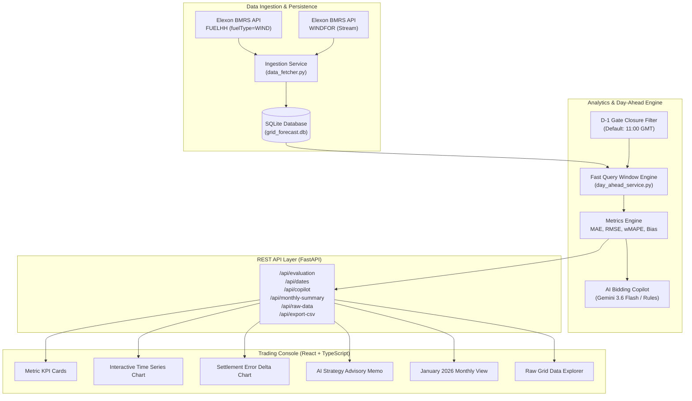

# 🌐 GridForecast: Technical Architecture & Domain Design Document

> **Renewable Wind Generation Day-Ahead Forecast & Quantitative Error Analytics Platform**  
> Designed for UK Wholesale Electricity Procurement & Day-Ahead Trading Desks  
> Built with Python 3.10+, FastAPI, SQLite, React 18, TypeScript, Tailwind CSS, and Google Gemini AI.

---

## 1. Executive Summary & Domain Problem

In the UK wholesale electricity market, energy utilities must balance consumer electricity demand with generation across **48 half-hour settlement periods** each day (from 00:00 to 24:00 UTC).

Wind generation supplies a substantial portion of the national load, but wind speed is volatile and weather-dependent. To cover anticipated deficits, utilities trade on the **Day-Ahead Wholesale Market** (e.g., EPEX SPOT and Nord Pool).

### The Day-Ahead Decision Dilemma
1. **Auction Gate Closure:** Day-ahead purchase bids must be finalized and submitted on day $D-1$ before gate closure (standard: **11:00 GMT**).
2. **Forecast Dependency:** The trading desk must rely on the latest available wind generation forecast published prior to that deadline.
3. **The Financial Cost of Error:**
   * **Under-Forecasting (Forecast < Actual):** The trader assumes renewable supply is lower than it turns out to be. The utility over-procures expensive thermal (gas/coal) generation on day-ahead, incurring needless fuel and carbon allowance costs.
   * **Over-Forecasting (Forecast > Actual):** The trader assumes abundant wind that fails to materialize. In real-time delivery, the utility experiences a supply shortfall and faces punitive cash-out prices in the **Balancing Mechanism (BM)**.

**GridForecast** equips procurement desks with:
* The exact day-ahead forecast trajectory available at gate closure cutoff.
* Rigorous statistical error metrics (MAE, RMSE, wMAPE, Bias) benchmarking forecast accuracy against ground-truth delivered power.
* An **AI Day-Ahead Bidding Copilot** (Gemini AI + local rules engine) translating statistical variance into commercial dispatch guidance.

---

## 2. High-Level System Architecture



---

## 3. Project Structure & Annotated File Map

### 3.1 Annotated Architecture Tree
```text
D:\Django\FORECAST/
├── run.py                           ──> Root one-command launcher (launches FastAPI + static React build on port 8000)
├── Dockerfile                       ──> Multi-stage Docker container (Node 20 frontend build + Python 3.10 slim runtime)
├── docker-compose.yml               ──> Docker Compose orchestration mapping port 8000 and data volume mounts
├── vercel.json                      ──> Vercel multi-service configuration routing /api to backend and / to frontend
├── .env.example                     ──> Environment variables template specifying GEMINI_API_KEY and gate cutoff
├── .gitignore                       ──> Excludes secrets (.env), node_modules, Python venvs, build dists, and caches
├── README.md                        ──> Primary public GitHub documentation with architecture overview and live URL
├── DOCUMENTATION.md                 ──> Technical architecture, mathematical formulations, and domain design spec
│
├── backend/                         ──> Python FastAPI backend service
│   ├── main.py                      ──> Vercel serverless service entrypoint exposing the FastAPI ASGI app
│   ├── run.py                       ──> Convenience runner allowing `python run.py` directly from within backend/
│   ├── requirements.txt             ──> Python production dependencies (FastAPI, Pydantic, GenAI, Tenacity)
│   └── app/                         ──> Core backend application package
│       ├── __init__.py              ──> Package initialization with version metadata
│       ├── main.py                  ──> FastAPI application factory, CORS middleware, and static asset mount
│       ├── config.py                ──> Environment settings, directory resolution, and gate closure defaults
│       ├── api/                     ──> API routing layer
│       │   ├── __init__.py          ──> API package initialization
│       │   └── routes.py            ──> REST endpoints (/health, /dates, /evaluation, /copilot, /monthly-summary, /raw-data, /export-csv)
│       ├── services/                ──> Business logic and domain processing layer
│       │   ├── __init__.py          ──> Services package initialization
│       │   ├── data_fetcher.py      ──> Elexon BMRS ingestion script streaming FUELHH and WINDFOR into SQLite
│       │   ├── day_ahead_service.py ──> D-1 gate closure cutoff enforcement, SQL window alignment, and raw data queries
│       │   ├── metrics_engine.py    ──> Math engine computing MAE, RMSE, wMAPE, Mean Bias, and Max Deficits
│       │   └── ai_copilot.py        ──> Gemini 3.6/3.5 Flash trading advisory with tenacity async retries & rule fallback
│       ├── data/                    ──> Persistence and ground-truth storage
│       │   └── grid_forecast.db     ──> Indexed SQLite database (1,489 actual wind records & 19,272 forecasts)
│       └── tests/                   ──> Automated testing suite
│           ├── __init__.py          ──> Tests package initialization
│           ├── test_metrics.py      ──> Unit tests for statistical formulas, calm-wind wMAPE, and bias checks
│           └── test_api.py          ──> API integration tests validating routes, database state, raw data, and CSV exports
│
└── frontend/                        ──> React 18 + TypeScript + Vite frontend client
    ├── index.html                   ──> Single-page application HTML entrypoint with dark-mode defaults
    ├── package.json                 ──> Frontend dependencies (React, Recharts, Lucide, Tailwind, Axios)
    ├── vite.config.ts               ──> Vite bundler config with development reverse proxy to :8000
    ├── tailwind.config.js           ──> Tailwind dark-theme palette customization for power trading UI
    ├── postcss.config.js            ──> PostCSS plugin configuration for Tailwind and Autoprefixer
    ├── tsconfig.json                ──> TypeScript compiler options and strict typing definitions
    └── src/                         ──> Application source code
        ├── main.tsx                 ──> React DOM root renderer
        ├── App.tsx                  ──> Master component managing global state, 3-way tab switching, and API fetching
        ├── index.css                ──> Global Tailwind CSS styles and custom scrollbar rules
        ├── types/                   ──> TypeScript interface definitions
        │   └── index.ts             ──> Data models for DailyMetrics, SettlementPeriodData, RawGridData, and Copilot
        └── components/              ──> Modular UI presentation components
            ├── Header.tsx           ──> Navigation bar with date picker, D-1 cutoff selector, and 3-way tab switch
            ├── MetricCards.tsx      ──> 6 instant KPI cards displaying MAE, RMSE, wMAPE, Bias, Deficit, Volume
            ├── ForecastChart.tsx    ──> 48 settlement periods interactive line overlay (Actual vs Forecast)
            ├── ErrorAnalysisChart.tsx ──> Settlement period error distribution bar chart ((Forecast - Actual) in MW)
            ├── DayAheadCopilot.tsx  ──> Commercial Bidding Strategy card powered by Gemini AI
            ├── SettlementTable.tsx  ──> 48-period expandable data table with status filtering and CSV export
            ├── MonthlyBenchmarkView.tsx ──> Full month January 2026 macro benchmark with 31-day error distribution
            └── RawDataExplorer.tsx  ──> Ground-truth Elexon stream auditor (FUELHH vs WINDFOR) with lead-time tracking
```

---

### 3.2 Comprehensive File Purpose & Responsibility Table

| File Path | Component Layer | Primary Purpose | Key Functions / Classes / Details |
| :--- | :--- | :--- | :--- |
| [`run.py`](file:///D:/Django/FORECAST/run.py) | **Application Entry** | Single-command launcher for local operations | Auto-verifies database presence, launches Uvicorn on port 8000, and auto-opens browser. |
| [`Dockerfile`](file:///D:/Django/FORECAST/Dockerfile) | **Containerization** | Production multi-stage container build | Stage 1 compiles Vite React assets; Stage 2 runs Python 3.10 slim runtime serving API and static assets. |
| [`vercel.json`](file:///D:/Django/FORECAST/vercel.json) | **Cloud Deployment** | Vercel multi-service routing specification | Defines `backend` (FastAPI) and `frontend` (Vite) services, routes `/api/*` to backend and `/*` to frontend, bundles `*.db`. |
| [`backend/main.py`](file:///D:/Django/FORECAST/backend/main.py) | **Serverless Entry** | Vercel serverless ASGI handler | Adds backend path to `sys.path` and exposes the FastAPI `app` object for serverless execution. |
| [`backend/app/main.py`](file:///D:/Django/FORECAST/backend/app/main.py) | **Web Framework** | FastAPI app factory and routing hub | Configures CORS, mounts OpenAPI Swagger at `/docs`, mounts API router, and serves frontend static assets. |
| [`backend/app/config.py`](file:///D:/Django/FORECAST/backend/app/config.py) | **Configuration** | Centralized environment & path settings | Resolves absolute database paths, loads `.env` securely, sets default gate closure hour (11:00 GMT). |
| [`backend/app/api/routes.py`](file:///D:/Django/FORECAST/backend/app/api/routes.py) | **API Layer** | REST API endpoints for frontend consumption | Exposes `/health`, `/dates`, `/evaluation`, `/copilot`, `/monthly-summary`, `/raw-data`, and `/export-csv`. |
| [`data_fetcher.py`](file:///D:/Django/FORECAST/backend/app/services/data_fetcher.py) | **Data Ingestion** | Elexon BMRS ingestion & SQLite persistence | Queries `FUELHH/stream` and `WINDFOR/stream`, filters `fuelType == 'WIND'`, stores records with indexes. |
| [`day_ahead_service.py`](file:///D:/Django/FORECAST/backend/app/services/day_ahead_service.py) | **Domain Service** | Day-Ahead market cutoff & alignment engine | Uses SQL `ROW_NUMBER() OVER` to match the latest forecast before D-1 11:00 GMT with actuals across 48 periods. |
| [`metrics_engine.py`](file:///D:/Django/FORECAST/backend/app/services/metrics_engine.py) | **Math Engine** | Quantitative accuracy calculations | Computes MAE, RMSE, wMAPE (volume-weighted), Mean Bias, and Max Deficit per day and month. |
| [`ai_copilot.py`](file:///D:/Django/FORECAST/backend/app/services/ai_copilot.py) | **AI Agent Layer** | Gemini trading commentary & bidding advisory | Hardcodes Primary (`gemini-3.6-flash`) & Backup (`gemini-3.5-flash`) with Tenacity async retries and offline rules fallback. |
| [`grid_forecast.db`](file:///D:/Django/FORECAST/backend/app/data/grid_forecast.db) | **Database** | Indexed local SQLite database | Houses 1,489 actual wind generation rows and 19,272 forecast rows for instant sub-millisecond querying. |
| [`test_metrics.py`](file:///D:/Django/FORECAST/backend/app/tests/test_metrics.py) | **Testing** | Unit tests for mathematical formulations | Tests zero-error bounds, over-forecasting bias, under-forecasting bias, and calm-wind wMAPE protection. |
| [`test_api.py`](file:///D:/Django/FORECAST/backend/app/tests/test_api.py) | **Testing** | API endpoint and data integrity tests | Asserts healthy DB status, validates 31-day January count, verifies 48-period alignment and CSV streaming. |
| [`frontend/src/App.tsx`](file:///D:/Django/FORECAST/frontend/src/App.tsx) | **Frontend Core** | Master React state coordinator | Manages active date, cutoff hour, tab switching, and asynchronous Axios API requests. |
| [`Header.tsx`](file:///D:/Django/FORECAST/frontend/src/components/Header.tsx) | **UI Component** | Navigation header & trading controls | Provides date navigation, D-1 gate cutoff selector dropdown, tab toggle, and CSV export button. |
| [`MetricCards.tsx`](file:///D:/Django/FORECAST/frontend/src/components/MetricCards.tsx) | **UI Component** | 6 Instant KPI metric cards | Renders MAE (MW), RMSE (MW), Volume wMAPE (%), Mean Bias (MW), Peak Deficit (MW), and Total Volume (GWh). |
| [`ForecastChart.tsx`](file:///D:/Django/FORECAST/frontend/src/components/ForecastChart.tsx) | **UI Component** | Interactive time-series overlay chart | Recharts multi-line visualization of Actual delivered power vs Day-Ahead forecast across 48 periods. |
| [`ErrorAnalysisChart.tsx`](file:///D:/Django/FORECAST/frontend/src/components/ErrorAnalysisChart.tsx) | **UI Component** | Error distribution delta visualizer | Color-coded bar chart displaying $(Forecast - Actual)$ with visual deficit vs surplus breakdown. |
| [`DayAheadCopilot.tsx`](file:///D:/Django/FORECAST/frontend/src/components/DayAheadCopilot.tsx) | **UI Component** | Gemini AI commercial strategy panel | Displays headline, risk tier badge (`LOW`/`MODERATE`/`HIGH`/`CRITICAL`), and thermal buffer bidding advice. |
| [`SettlementTable.tsx`](file:///D:/Django/FORECAST/frontend/src/components/SettlementTable.tsx) | **UI Component** | 48-period detailed data ledger | Expandable table with deficit/surplus filtering and period-by-period numerical audit trail. |
| [`MonthlyBenchmarkView.tsx`](file:///D:/Django/FORECAST/frontend/src/components/MonthlyBenchmarkView.tsx) | **UI Component** | January 2026 full-month macro view | 31-day daily wMAPE bar chart with 1-click drill-down and aggregate monthly statistics. |
| [`RawDataExplorer.tsx`](file:///D:/Django/FORECAST/frontend/src/components/RawDataExplorer.tsx) | **UI Component** | Ground-truth Elexon stream inspector | Toggleable FUELHH vs WINDFOR table with status badges (Locked D-1 vs Superseded vs Intraday) and direct Elexon documentation links. |

---

## 4. Data Ingestion & Gate Closure Alignment

### 4.1 Datasets
* **Actual Wind Generation (`FUELHH`):** Half-hourly national generation records (MW). Scoped to `fuelType == 'WIND'` for all 31 days of January 2026.
* **Forecasted Generation (`WINDFOR`):** National wind predictions with `startTime` (target period) and `publishTime` (time forecast was generated).

### 4.2 Cutoff Enforcement Logic
Multiple forecasts exist for every target delivery period. A trader placing bids on Day $D-1$ at 11:00 GMT cannot see forecasts published at 14:00 GMT or 18:00 GMT.

```python
# Cutoff calculation for delivery date D:
target_date = datetime.strptime(delivery_date, "%Y-%m-%d")
d_minus_1 = target_date - timedelta(days=1)
cutoff_time = d_minus_1.replace(hour=gate_closure_hour, minute=0, second=0)

# SQL Window Function retrieves only the latest forecast published BEFORE cutoff:
SELECT start_time, generation, publish_time
FROM (
    SELECT start_time, generation, publish_time,
           ROW_NUMBER() OVER (PARTITION BY start_time ORDER BY publish_time DESC) as rn
    FROM forecast_generation
    WHERE publish_time <= :cutoff_iso
      AND start_time >= :day_start AND start_time <= :day_end
) WHERE rn = 1
```

---

## 5. Raw Grid Data Explorer & Telemetry Audit

To guarantee 100% data transparency and reproducibility, GridForecast provides a dedicated **Raw Grid Data Explorer** (`/api/raw-data` & UI Tab 3) allowing procurement officers, risk managers, and interview evaluators to inspect unmanipulated Elexon stream telemetry:

1. **Dual Dataset Inspection:**
   - **`FUELHH` Stream:** Displays all 48 half-hourly delivered generation records with Settlement Period (1–48), UTC interval timestamps, and verified delivery badges.
   - **`WINDFOR` Stream:** Displays every forecast revision published by National Grid ESO targeting each hour of the selected date (over 500+ stream updates per day).
2. **Cutoff Decision Audit:**
   - Visual color badges distinguish between:
     - 🟢 **Selected (Day-Ahead Bid):** The exact snapshot locked before D-1 11:00 GMT and submitted to the auction.
     - ⚪ **Superseded:** Pre-cutoff forecast updates replaced by a fresher forecast prior to gate closure.
     - 🟡 **Post-Cutoff (Intraday):** Forecasts published after gate closure — legally prohibited from Day-Ahead auction bidding.
3. **Official BMRS API Direct Verification:**
   - Direct clickable links to the live Elexon BMRS endpoint documentation:
     - [`FUELHH Stream Documentation`](https://bmrs.elexon.co.uk/api-documentation/endpoint/datasets/FUELHH/stream)
     - [`WINDFOR Stream Documentation`](https://bmrs.elexon.co.uk/api-documentation/endpoint/datasets/WINDFOR/stream)

---

## 6. Quantitative Evaluation Methodology

Let $y_i$ be actual wind generation and $\hat{y}_i$ be the forecasted generation for settlement period $i \in \{1, \dots, N\}$.

### 6.1 Mean Absolute Error (MAE)
$$\text{MAE} = \frac{1}{N} \sum_{i=1}^N |y_i - \hat{y}_i|$$
Measures average expected error magnitude per 30-minute block.

### 6.2 Root Mean Square Error (RMSE)
$$\text{RMSE} = \sqrt{\frac{1}{N} \sum_{i=1}^N (y_i - \hat{y}_i)^2}$$
Penalizes severe forecast deviations (crucial for grid stability and large imbalance exposures).

### 6.3 Weighted Mean Absolute Percentage Error (wMAPE)
$$\text{wMAPE} = \frac{\sum_{i=1}^N |y_i - \hat{y}_i|}{\sum_{i=1}^N y_i} \times 100\%$$
> **Domain Note:** Standard unweighted MAPE ($\frac{1}{N}\sum \frac{|y - \hat{y}|}{y}$) explodes during low-wind/calm periods due to division by near-zero denominators. Power utilities universally prefer **volume-weighted MAPE (wMAPE)** or Normalized MAE as their contractual accuracy benchmark.

### 6.4 Mean Forecast Bias (MBE)
$$\text{Bias} = \frac{1}{N} \sum_{i=1}^N (\hat{y}_i - y_i)$$
* **$\text{Bias} > +50\text{ MW}$:** Systematic over-forecasting (under-procurement risk).
* **$\text{Bias} < -50\text{ MW}$:** Systematic under-forecasting (thermal over-procurement risk).
* **$-50 \le \text{Bias} \le +50\text{ MW}$:** Well-balanced forecast.

---

## 7. AI Day-Ahead Trading Copilot

The AI Copilot connects to **Google Gemini 3.6 Flash** (with automatic fallback to **Gemini 3.5 Flash** and Tenacity exponential retries) to act as an automated commercial dispatch analyst.

### Operational Workflow:
1. Feeds summary metrics, error bias, peak deficit settlement periods, and volume deltas into a specialized power market prompt.
2. Returns a structured JSON memo with:
   * Executive Headline
   * Imbalance Risk Tier (`LOW`, `MODERATE`, `HIGH`, `CRITICAL`)
   * Reliability Assessment
   * Actionable Bidding Strategy (recommended thermal buffer procurement).
3. **Deterministic Fallback:** If `GEMINI_API_KEY` is not provided or both API calls fail, the system executes an offline deterministic energy rules engine that provides identical schema guarantees with zero downtime.

---

## 8. Verification & Automated Test Suite

The test suite covers:
* `test_metrics_calculation_perfect_match`: Validates zero-error boundary conditions.
* `test_metrics_over_forecasting`: Verifies positive bias and deficit tracking.
* `test_metrics_under_forecasting`: Verifies negative bias and surplus tracking.
* `test_wmape_handles_calm_wind`: Guarantees no division by zero during calm wind periods.
* `test_health_logic`: Verifies database integrity across all records.
* `test_get_dates_logic`: Validates full 31-day coverage of January 2026.
* `test_evaluation_logic`: Verifies 48 settlement period alignment.
* `test_monthly_summary_logic`: Verifies aggregate month statistics.
* `test_csv_export_logic`: Verifies CSV formatting and headers.

All tests run via:
```bash
python -m pytest backend/app/tests -v
```
