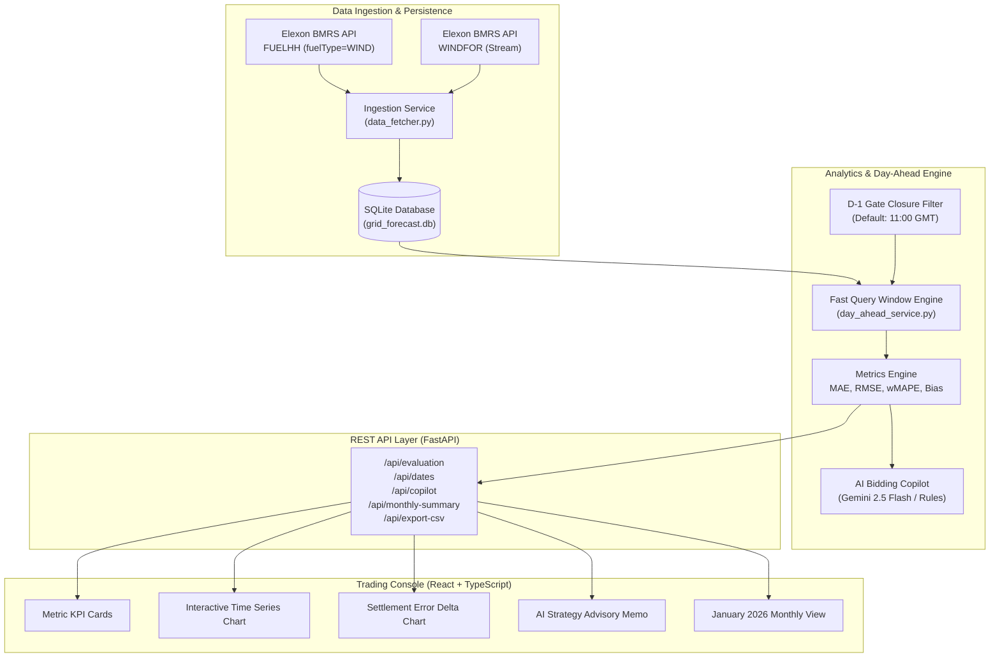

# 🌐 GridForecast: Technical Architecture & Domain Design Document

> **Renewable Wind Generation Day-Ahead Forecast & Quantitative Error Analytics Platform**  
> Designed for UK Wholesale Electricity Procurement & Day-Ahead Trading Desks  
> Built with Python 3.10+, FastAPI, SQLite, React 18, TypeScript, Tailwind CSS, and Google Gemini AI.

---

## 1. Executive Summary & Domain Problem

In the UK wholesale electricity market, energy utilities must balance consumer electricity demand with generation across **48 half-hour settlement periods** each day (from 00:00 to 24:00 UTC).

Wind generation supplies a substantial portion of the national load, but wind speed is volatile and weather-dependent. To cover anticipated deficits, utilities trade on the **Day-Ahead Wholesale Market** (e.g., EPEX SPOT and Nord Pool).

### The Day-Ahead Decision Dilemma
1. **Auction Gate Closure:** Day-ahead purchase bids must be finalized and submitted on day $D-1$ before gate closure (standard: **11:00 GMT**).
2. **Forecast Dependency:** The trading desk must rely on the latest available wind generation forecast published prior to that deadline.
3. **The Financial Cost of Error:**
   * **Under-Forecasting (Forecast < Actual):** The trader assumes renewable supply is lower than it turns out to be. The utility over-procures expensive thermal (gas/coal) generation on day-ahead, incurring needless fuel and carbon allowance costs.
   * **Over-Forecasting (Forecast > Actual):** The trader assumes abundant wind that fails to materialize. In real-time delivery, the utility experiences a supply shortfall and faces punitive cash-out prices in the **Balancing Mechanism (BM)**.

**GridForecast** equips procurement desks with:
* The exact day-ahead forecast trajectory available at gate closure cutoff.
* Rigorous statistical error metrics (MAE, RMSE, wMAPE, Bias) benchmarking forecast accuracy against ground-truth delivered power.
* An **AI Day-Ahead Bidding Copilot** (Gemini AI + local rules engine) translating statistical variance into commercial dispatch guidance.

---

## 2. High-Level System Architecture



---

## 3. Data Ingestion & Gate Closure Alignment

### 3.1 Datasets
* **Actual Wind Generation (`FUELHH`):** Half-hourly national generation records (MW). Scoped to `fuelType == 'WIND'` for all 31 days of January 2026.
* **Forecasted Generation (`WINDFOR`):** National wind predictions with `startTime` (target period) and `publishTime` (time forecast was generated).

### 3.2 Cutoff Enforcement Logic
Multiple forecasts exist for every target delivery period. A trader placing bids on Day $D-1$ at 11:00 GMT cannot see forecasts published at 14:00 GMT or 18:00 GMT.

```python
# Cutoff calculation for delivery date D:
target_date = datetime.strptime(delivery_date, "%Y-%m-%d")
d_minus_1 = target_date - timedelta(days=1)
cutoff_time = d_minus_1.replace(hour=gate_closure_hour, minute=0, second=0)

# SQL Window Function retrieves only the latest forecast published BEFORE cutoff:
SELECT start_time, generation, publish_time
FROM (
    SELECT start_time, generation, publish_time,
           ROW_NUMBER() OVER (PARTITION BY start_time ORDER BY publish_time DESC) as rn
    FROM forecast_generation
    WHERE publish_time <= :cutoff_iso
      AND start_time >= :day_start AND start_time <= :day_end
) WHERE rn = 1
```

---

## 4. Quantitative Evaluation Methodology

Let $y_i$ be actual wind generation and $\hat{y}_i$ be the forecasted generation for settlement period $i \in \{1, \dots, N\}$.

### 4.1 Mean Absolute Error (MAE)
$$\text{MAE} = \frac{1}{N} \sum_{i=1}^N |y_i - \hat{y}_i|$$
Measures average expected error magnitude per 30-minute block.

### 4.2 Root Mean Square Error (RMSE)
$$\text{RMSE} = \sqrt{\frac{1}{N} \sum_{i=1}^N (y_i - \hat{y}_i)^2}$$
Penalizes severe forecast deviations (crucial for grid stability and large imbalance exposures).

### 4.3 Weighted Mean Absolute Percentage Error (wMAPE)
$$\text{wMAPE} = \frac{\sum_{i=1}^N |y_i - \hat{y}_i|}{\sum_{i=1}^N y_i} \times 100\%$$
> **Domain Note:** Standard unweighted MAPE ($\frac{1}{N}\sum \frac{|y - \hat{y}|}{y}$) explodes during low-wind/calm periods due to division by near-zero denominators. Power utilities universally prefer **volume-weighted MAPE (wMAPE)** or Normalized MAE as their contractual accuracy benchmark.

### 4.4 Mean Forecast Bias (MBE)
$$\text{Bias} = \frac{1}{N} \sum_{i=1}^N (\hat{y}_i - y_i)$$
* **$\text{Bias} > +50\text{ MW}$:** Systematic over-forecasting (under-procurement risk).
* **$\text{Bias} < -50\text{ MW}$:** Systematic under-forecasting (thermal over-procurement risk).
* **$-50 \le \text{Bias} \le +50\text{ MW}$:** Well-balanced forecast.

---

## 5. AI Day-Ahead Trading Copilot

The AI Copilot connects to **Google Gemini 3.6 Flash** (via `google-genai` SDK) to act as an automated commercial dispatch analyst.

### Operational Workflow:
1. Feeds summary metrics, error bias, peak deficit settlement periods, and volume deltas into a specialized power market prompt.
2. Returns a structured JSON memo with:
   * Executive Headline
   * Imbalance Risk Tier (`LOW`, `MODERATE`, `HIGH`, `CRITICAL`)
   * Reliability Assessment
   * Actionable Bidding Strategy (recommended thermal buffer procurement).
3. **Deterministic Fallback:** If `GEMINI_API_KEY` is not provided, the system executes an offline deterministic energy rules engine that provides identical schema guarantees with zero downtime.

---

## 6. Verification & Automated Test Suite

The test suite covers:
* `test_metrics_calculation_perfect_match`: Validates zero-error boundary conditions.
* `test_metrics_over_forecasting`: Verifies positive bias and deficit tracking.
* `test_metrics_under_forecasting`: Verifies negative bias and surplus tracking.
* `test_wmape_handles_calm_wind`: Guarantees no division by zero during calm wind periods.
* `test_health_logic`: Verifies database integrity across all records.
* `test_get_dates_logic`: Validates full 31-day coverage of January 2026.
* `test_evaluation_logic`: Verifies 48 settlement period alignment.
* `test_monthly_summary_logic`: Verifies aggregate month statistics.
* `test_csv_export_logic`: Verifies CSV formatting and headers.

All tests run via:
```bash
python -m pytest backend/app/tests -v
```
